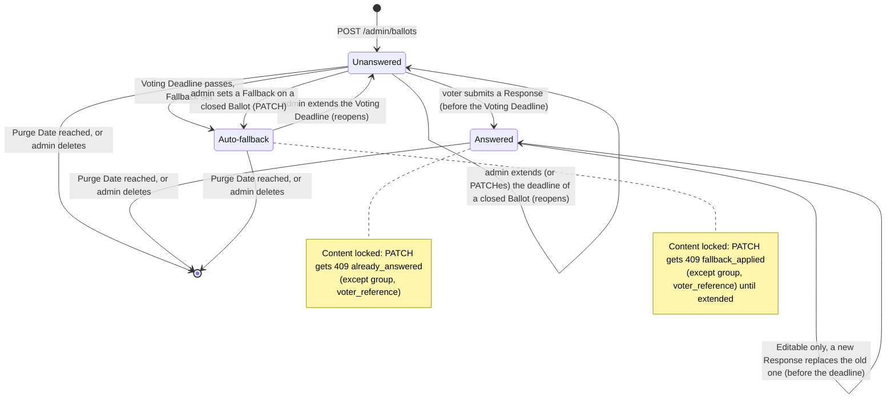

# Ballot lifecycle and Ballot Status

A **Ballot** is one voter's personal voting form. An admin creates it through the [admin API](../reference/admin-api.md), hands its URL (which contains the **Ballot Token**) to exactly one voter, and later reads its result. After its **Purge Date** the Ballot is gone.

## The lifecycle

1. **Created.** `POST /admin/ballots` stores the Ballot with a fresh Ballot Token and fresh Option IDs and returns the public URL `<public_base_url>b/<token>`. An **Editable** Ballot with a **Preselection** starts Answered (see [below](#preselection)); every other Ballot starts Unanswered.
2. **Open.** Until the **Voting Deadline** the voter can answer on the voting page or through the [voter API](../reference/voter-api.md). While the Ballot has no **Response**, the admin can still edit it, including its Options.
3. **Answered.** The voter's first Response makes the Ballot Answered. On a multiple-choice Ballot with **Allow No Option** (`allow_no_option`), that Response may select no Option at all ("none of these"): it is still a Response, so the Ballot is Answered and its Fallback never applies. Without the setting a Response always selects at least one Option. A **Final** Ballot is now locked. An **Editable** Ballot keeps accepting new Responses (the last one wins) until the Voting Deadline. From now on the admin may only change the Group and the Voter Reference, extend the deadline, or delete the Ballot.
4. **Closed.** The Voting Deadline is exclusive: from that instant on, no Response is accepted or changed. If there is no Response, the **Fallback** (if any) becomes the result (Auto-fallback). From then on the admin can no longer change the Ballot's content, only the Group and the Voter Reference, until they extend the deadline. A closed Ballot without a Fallback stays editable; an edit that gives it a Fallback applies that Fallback at once, and the Ballot is Auto-fallback.
5. **Reopened (optional).** Extending the Voting Deadline into the future reopens the Ballot, and an Auto-fallback Ballot can be edited again. See [Deadlines, Fallback and Purge](deadlines-fallback-purge.md).
6. **Gone.** From the Purge Date on, every lookup treats the Ballot as non-existent. The purge sweep later deletes the row. An admin can also delete a Ballot early with `DELETE /admin/ballots/{id}`.

## Ballot Status is derived, never stored

The Ballot Status is computed on every request from four inputs: the current time (from the Clock), the Voting Deadline, the Response, and the Fallback (see `Ballot::status` in `src/domain/ballot.rs`):

| Response? | Voting open (`now < voting_deadline`)? | Fallback? | Ballot Status   | Result                     |
| --------- | -------------------------------------- | --------- | --------------- | -------------------------- |
| yes, the voter's (possibly of no Option) | either      | either    | `answered`      | the Response (`response`)  |
| yes, the Preselection's (Editable only) | either       | either    | `answered`      | the Preselection (`preselection`) |
| no        | yes                                    | either    | `unanswered`    | none (`null`)              |
| no        | no                                     | yes       | `auto_fallback` | the Fallback (`fallback`)  |
| no        | no                                     | no        | `unanswered`    | none (`null`)              |

"Response?" asks whether there is one, not whether it selects Options: a Response of no Option (Allow No Option) is a stored Response with `option_ids: []`, and "no Response" is `response: null`. The store keeps the two apart (a `responses` row without `response_options` rows, versus no row at all).

The APIs use the wire names `unanswered`, `answered` and `auto_fallback`. The voting page shows them as "Unanswered", "Answered" and "Auto-fallback".

Nothing is written when the deadline passes. That is why extending the deadline turns an `auto_fallback` Ballot back into `unanswered` without anyone having to undo anything.

## Preselection

The admin may give a Ballot a **Preselection**: Options the voting page shows ticked before the voter does. It obeys the Choice Mode like a Fallback (never empty) and is independent of it.

- On a **Final** Ballot it only ticks the Options (with the hint "Preselected; confirm or change, then submit."). The voter still submits and confirms; nothing is recorded before that, so the Ballot is Unanswered until then and the Fallback applies at the deadline as usual.
- On an **Editable** Ballot it is **saved as the answer already**: the store records it as the Response, of origin `preselection`, when the Ballot is created. The Ballot is Answered from the start, so the Fallback never applies; the page says "Preselected for you. You can change it until voting closes." Once the voter saves anything, **even the same Options**, the Response is the voter's (origin `voter`), and the rules of an Answered Ballot apply.

While voting is open and the Response is still the Preselection's, the voter hasn't acted, so the admin may still make content edits: the Ballot is edited as if Unanswered, and the edit records the resulting Preselection anew as the Response (none if the edit removes the Preselection or makes the Ballot Final; making a Final Ballot Editable records it). Once the deadline has passed with the Preselection as the Response, it is the recorded result, so content edits get `409 already_answered` until the deadline is extended, just as an applied Fallback locks an Auto-fallback Ballot. The rules are tested in `tests/preselection.rs`.

## What the admin may do in each state

| Action                                       | Unanswered | Answered        | Auto-fallback   |
| -------------------------------------------- | ---------- | --------------- | --------------- |
| `PATCH` content and settings (any field)     | yes        | no, 409 `already_answered` (yes while open if the Response is the Preselection's) | no, 409 `fallback_applied` |
| `PATCH` only `group` and/or `voter_reference` | yes       | yes             | yes             |
| `POST …/extend` (later Voting Deadline)      | yes        | yes             | yes (reopens)   |
| `DELETE`                                     | yes        | yes             | yes             |

A content edit is allowed only while the Ballot is Unanswered: not once it has a Response (Answered), so a voter's Response never silently changes meaning, and not once its Fallback has applied (Auto-fallback), so a recorded result doesn't change either. Extending the deadline turns an Auto-fallback Ballot back into Unanswered, and then content edits are allowed again. A Ballot whose deadline passed **without** a Fallback is Unanswered, so it stays editable; a `PATCH` with a new `voting_deadline` reopens it too, and a `PATCH` that gives it a Fallback applies that Fallback at once (Auto-fallback). The rules are tested in `tests/admin_edit.rs` and `tests/admin_edit_after_fallback.rs`. Turning Allow No Option on or off is a content edit too, so a recorded Response of no Option can never be left on a Ballot that no longer allows it: once Answered, the edit gets `409 already_answered`, and before that the revision guard (below) refuses a Response of no Option made on the page as it was. An edit naming only `group` and/or `voter_reference` is a *bookkeeping* edit. It is allowed at any time because the voter never sees those fields. Any other field present in the body makes it a *content* edit, even if its value is unchanged.

## Concurrency guarantees

The Ballot store makes these guarantees (`src/data/ballot_store.rs` and its submodules in `src/data/ballot_store/`: `responses.rs` records Responses, `edit.rs` edits and extends):

- **A Final Ballot never gets two Responses.** The Response row is one conditional `INSERT … ON CONFLICT DO NOTHING` keyed on the Ballot, so even a double-click or two parallel requests store exactly one Response.
- **The deadline is checked in the same write.** A Response racing the deadline (or an extension) cannot slip in afterwards.
- **The revision guard.** Every content edit bumps the Ballot's `revision`, which the voter sees (voter API, hidden form field) and must send back with the Response. A Response is only recorded if that revision is still the Ballot's, in the same conditional write, so it is never recorded against a Ballot the voter didn't see. Otherwise the voter gets `409 ballot_changed` and must look at the Ballot again. Bookkeeping edits and extensions don't bump the revision.
- **A content edit and a Response can't both win.** An edit runs in an immediate (write-locked) transaction, and its write is conditional on the Ballot still having no Response of the voter. (A Response from the Preselection is replaced by the edit, in the same transaction; a voter's save racing the edit carries the old revision and is refused.)
- **A content edit can't slip in at the deadline.** The same conditional write also requires that the Fallback has not applied: it does not match if the stored Voting Deadline is at or before the request's time and the Ballot has a Fallback, or a Response from the Preselection. An edit arriving exactly at the deadline gets `409 fallback_applied` (or `409 already_answered`).

## Related

- [Deadlines, Fallback and Purge](deadlines-fallback-purge.md)
- [Trust boundary and sanitization](trust-boundary.md)
- Glossary: [`CONTEXT.md`](../../CONTEXT.md)
