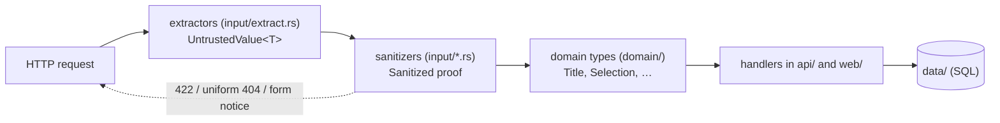

# Trust boundary and sanitization

Every value that comes from outside the process is untrusted until a sanitizer has checked it. All sanitizers live in one module, `src/input/`, so a security review can concentrate there. This page describes how that works and lists every rule.

## The `untrusted_value` pattern

Vota uses the [`untrusted_value`](https://crates.io/crates/untrusted_value) crate to make the boundary a compile-time property:

1. **Extractors wrap raw input.** The axum extractors in `src/input/extract.rs` (`UntrustedJson`, `UntrustedForm`, `UntrustedQuery`, `BallotTokenPath`, `BallotIdPath`, `AssetNamePath`, `AssetQuery`) turn request bodies, query strings and path segments into `UntrustedValue<T>`. Request DTOs such as `CreateBallotRequest` keep their fields private, so a handler can pass a request on but never read it.
2. **Sanitizers are the only way out.** Functions such as `input::new_ballot`, `input::ballot_changes`, `input::api_response` and `input::form_response` unbox the value with `sanitize_with` and return validated domain types.
3. **Domain types demand a proof.** Constructors like `Title::new(text, Sanitized)` need a `Sanitized` token, and only `src/input/` can create one. So code outside `input` can't build a `Title`, `OptionLabels`, `VotingDeadline`, `ThemeName`, `AccentColor`, `Selection`, `OptionId`, `SeenRevision`, `BallotToken`, … from raw data. (Values read back from the database use `from_store` constructors: the store only ever holds sanitized values.)
4. **Errors never echo input.** A rejection carries the field name and a fixed reason, never the rejected value. Only names the endpoint's schema knows are reported: an unknown field (at any depth) or query/form parameter, or a name that isn't UTF-8, is reported as `"field": null`, so a request's own names never come back either. serde's own messages, which can contain input, are reduced to a category (`unknown field`, `missing`, `wrong type or value`). A body that is not valid JSON at all gets one fixed `422 invalid_json` without a field.

Request headers are not wrapped in `UntrustedValue`, but only these are read, and never stored or echoed:

- `Authorization` is the one value read outside `src/input/`: it is only hashed and compared with the stored hashes (`src/api/admin/auth.rs`).
- `Content-Type` is only compared with the expected media type (in the body extractors, `src/input/extract.rs`).
- `X-Forwarded-For` goes through a sanitizer like any other input, and only from a trusted proxy (`src/input/client_ip.rs`); the health check only asks whether `X-Forwarded-For` or `Forwarded` is present, never reading their values.

No other header is read: `Host`, `X-Forwarded-Host` and `X-Forwarded-Proto` never influence a response, and every URL the app generates comes from `public_base_url`. Besides headers, the TCP peer address is used for the rate limits and the health check.

## General rules

| Input | Rule |
| ----- | ---- |
| Body size | At most 64 KiB on the routes that read a body (`POST /admin/ballots`, `PATCH /admin/ballots/{id}`, `POST /admin/ballots/{id}/extend`, `PUT /api/b/{token}/response`, `POST /b/{token}`); above that `413`, also for a chunked body. Every other route never reads the body, so a body sent along is ignored, whatever its size. The form post looks up the Ballot Token (`404`) and checks that the Ballot takes a Response (`409`: closed, or Final and already answered) before it reads the body, so only a Ballot that accepts a Response gets the `413` or `415`. |
| JSON bodies | `Content-Type: application/json` (otherwise, or without the header, `415`). Only the media type before any `;` counts: it is compared ignoring ASCII case and surrounding spaces, and parameters are ignored, so `APPLICATION/JSON; charset=utf-8` is accepted. Must be valid JSON as a whole (UTF-8, complete, no trailing data, no number beyond the 64-bit float range, no lone surrogate escape like `"\ud800"`), otherwise `422 invalid_json`. The top level must be an object. Unknown fields are rejected. |
| Form bodies (`POST /b/{token}`) | `Content-Type: application/x-www-form-urlencoded`, matched like JSON's (otherwise `415`). Unknown fields are rejected. Every field is read as a list of values. Invalid UTF-8 is rejected. |
| Query strings (`GET /admin/ballots`) | Parsed like forms. Unknown parameters are rejected (`"field": null`). Each parameter at most once. Invalid UTF-8 in a known parameter's value names the parameter. |
| Enums (`choice_mode`, `submission_mode`, `status`) | Exact match against the known names: no trimming, no case folding. Absent means the default (create) or the current value (edit). `null` is rejected. |
| Optional fields | May be absent. `null` is rejected on creation. On edit, `null` removes the value for `description`, `fallback`, `group`, `voter_reference`, `accent_color` and `logo`, and is rejected for every other field. |

## Text

| Kind | Applies to | Rules |
| ---- | ---------- | ----- |
| Single-line text | `title`, Option `label`, `group`, `voter_reference`, Fallback labels, `group` filter, Admin Token labels (CLI) | Unicode NFC normalisation, then trim leading and trailing whitespace. Must not be empty. Rejects control characters (including newline and tab) and invisible, private-use and unassigned characters (see below), and more than four combining marks on one base character. Length is counted in characters **after** normalisation. |
| Multi-line text | `description` | First `\r\n` and lone `\r` become `\n`. Then the same as single-line, except that newline and tab are allowed. |

The rejected characters, so that texts that look alike can't pass as different (e.g. the Option labels `A` and `A` followed by an invisible variation selector):

- every character of the Unicode general categories **Cc** (control), **Cf** (format: bidi embeddings, overrides, isolates and marks, zero-width space and joiners, soft hyphen, word joiner, invisible operators, BOM, interlinear annotation, tag characters, prepended number signs such as U+0600–U+0605, U+06DD, U+070F, U+0890–U+0891, U+08E2, U+110BD, Egyptian hieroglyph format controls, shorthand format controls, musical beam controls, …), **Co** (private use) and **Cn** (unassigned, including the 66 noncharacters such as U+FDD0 and U+FFFE), as of the Unicode version of the `icu_properties` crate;
- invisible or blank characters of other categories: combining grapheme joiner (U+034F), Hangul fillers (U+115F, U+1160, U+3164, U+FFA0), Khmer inherent vowels (U+17B4–U+17B5), Mongolian variation selectors (U+180B–U+180D, U+180F), line and paragraph separators (U+2028, U+2029), the Braille pattern blank (U+2800), variation selectors (U+FE00–U+FE0F and U+E0100–U+E01EF) and the object replacement character (U+FFFC);
- a run of more than **four combining marks** (categories Mn, Mc, Me) on one base character, counted after normalisation ("Zalgo" stacks). Real scripts need fewer; e.g. Vietnamese, Hindi, Thai, Arabic and Hebrew with vowel points pass.

The messages are `contains control, invisible or unassigned characters` and `too many combining marks`.

The Markdown description is stored as sanitised *source*. HTML is produced only when the voting page is rendered, in two layers (`src/web/markdown.rs`):

1. `pulldown-cmark` (plain CommonMark, no extensions) drops raw HTML. Links lose their link (keeping their text) unless the target is an absolute `http`, `https` or `mailto` URL; link titles are dropped. Images are dropped, keeping their alt text. Headings become bold paragraphs. Nesting deeper than 16 elements is flattened.
2. `ammonia` cleans the result against an allowlist: `p`, `br`, `em`, `strong`, `a`, `ul`, `ol`, `li`, `code`, `blockquote`. The only attribute is `href` on links (same schemes), with `rel="noopener noreferrer nofollow"` added.

The voter API returns the source, not HTML.

## Every field

| Field / input | Where | Type | Limits and rules | On failure |
| ------------- | ----- | ---- | ---------------- | ---------- |
| `title` | admin create/edit | string | single-line text, 1–200 characters | `422 title` |
| `description` | admin create/edit | string | multi-line text, 1–10 000 characters; limited Markdown | `422 description` |
| `options` | admin create/edit | array of `{label}` | at least 2; each `label` single-line, 1–200 characters; labels unique (exact match after normalisation); edit replaces all, with new IDs | `422 options` / `options[i].label` |
| `choice_mode` | admin create/edit | string | `single` or `multiple` | `422 choice_mode` |
| `submission_mode` | admin create/edit | string | `final` or `editable` | `422 submission_mode` |
| `voting_deadline` | admin create/edit/extend | string | [RFC 3339](#timestamps) with offset (`Z` or `±hh:mm`); after now; at most now + `max_date_horizon`; on extend also later than the current one | `422 voting_deadline` |
| `purge_date` | admin create/edit | string | [RFC 3339](#timestamps) with offset; after now; at most now + `max_date_horizon`; not before the (resulting) Voting Deadline | `422 purge_date` |
| `fallback` | admin create/edit | array of strings | Option labels, each normalised like a label and matching one of the (resulting) Options exactly; no duplicates; count obeys the Choice Mode (never empty) | `422 fallback` / `fallback[i]` |
| `group` | admin create/edit, list filter | string | single-line text, 1–200 characters; the filter matches literally | `422 group` |
| `voter_reference` | admin create/edit | string | single-line text, 1–200 characters; unique within the Group | `422 voter_reference`; duplicate: `409 duplicate_voter_reference` |
| `theme` | admin create/edit | string | `^[a-z0-9][a-z0-9-]{0,63}$` exactly, then must be a known Theme (looked up by name in the registry, never joined onto a path); absent on edit: the current one is kept without a check | `422 theme` |
| `accent_color` | admin create/edit | string | `^#[0-9a-fA-F]{6}$` exactly (no shorthand, no names, no trimming); stored lowercase; only ever rendered as the value of the CSS custom property `--accent` | `422 accent_color` |
| `logo` | admin create/edit | string | name rule as `theme`, then must be a known logo; absent on edit: the current one is kept without a check | `422 logo` |
| `status` | admin list filter | string | `unanswered`, `answered` or `auto_fallback` | `422 status` |
| `{id}` path segment | admin Ballot routes | string | a positive decimal integer as the server writes it: ASCII digits only, no sign, no leading zero, fits a 64-bit integer, literal in the raw path (no `%`-encoding) | `404 {"error":"not_found"}`, same as unknown |
| `{token}` path segment | `/b/…`, `/api/b/…` | string | exactly 22 base64url characters that decode canonically to 16 bytes, literal in the raw path (no `%`-encoding, so a token has exactly one spelling in a URL); checked before any database lookup | uniform not-found (`404`) |
| `option_ids` | `PUT /api/b/{token}/response` | array of strings | each exactly 11 canonical base64url characters; no duplicates; each one of the Ballot's current Options; count obeys the Choice Mode | malformed/duplicate/count: `422 option_ids…`; not on this Ballot: `409 ballot_changed` |
| `option` | `POST /b/{token}` | repeated form field | as `option_ids` | form notice, `422`; not on this Ballot: `409` notice |
| `confirm` | `POST /b/{token}` | form field | absent, or exactly one `yes` | form notice, `422` |
| `revision` | `PUT /api/b/{token}/response` | integer | required; a JSON integer from 0 to 2^63−1 (no string, float or `null`); checked before the Options; must be the Ballot's current revision | `422 revision`; not the current one: `409 ballot_changed` |
| `revision` | `POST /b/{token}` | form field | required, exactly once; plain decimal digits (no sign, leading zero or spaces), at most 2^63−1; must be the Ballot's current revision | form notice, `422`; not the current one: `409` notice |
| `{name}` in `/assets/themes/{name}/style.css`, `/assets/logos/{name}` | assets | string | name rule as `theme`, literal in the raw path, must be known | plain `404`, not counted for rate limiting |
| `?v=` on `/assets/app/…` | assets | query string | compared as is with the current content version; anything else is not an error, just cached for 1 hour instead of a year | never rejected |
| `X-Forwarded-For` | every rate-limited request | header | read only if the peer is in `trusted_proxies` (ignored from any other peer); must be a comma-separated list of bare IPv4/IPv6 addresses (no ports, brackets or names), at most 32 hops across all occurrences of the header | `400` with the error headers, charged to no rate-limit bucket |
| `Authorization` | admin API | header | `Bearer <token>`, the scheme in any case; only hashed and compared | `401`; too many per client IP: `429` |
| Admin Token flags | CLI | arguments | `--expires-at` [RFC 3339](#timestamps) with offset, `--expires-in` humantime duration; either way in the future and no later than `9999-12-31T23:59:59Z`; `--label` (create) single-line text, 1–200 characters; `revoke <ID>` positive integer | exit 1 or 2 |

### Timestamps

`voting_deadline`, `purge_date` and `--expires-at` are parsed as RFC 3339 by `chrono`, which accepts a little more than the strict grammar. A timestamp needs a full date, a full time with seconds and an offset; anything shorter (no seconds, no offset, a date alone), a `+hhmm` or `+hh` offset, a comma before the fraction, surrounding whitespace or an impossible date or time (February 30, hour 24, minute 60 of an offset) is `422`. Accepted, besides the usual `2026-12-01T12:00:00Z` and `2026-12-01T13:00:00+01:00`:

- `t` or a single space instead of `T`, and `z` instead of `Z`;
- the offset `-00:00`, which counts as UTC;
- second `60` (a leap second) in any minute, which counts as the first moment of the next minute;
- any number of fractional digits.

Every accepted spelling is converted to UTC and stored as Unix milliseconds, so digits beyond the millisecond are cut off, and responses always show the stored value in one form: UTC with `Z`, and three fractional digits only when the milliseconds aren't zero (`2026-12-01T12:00:00Z`, `2026-12-01T12:00:00.500Z`). The checks (in the future, within `max_date_horizon`, the order of the dates) use the parsed value.

## Testing the boundary

Each sanitizer is tested through the HTTP seam with hostile inputs: overlong values, control, bidi and zero-width characters, path traversal, wrong formats, `null`, wrong types, unknown fields, repeated parameters, percent-encoding and invalid UTF-8. See the `*_hostile_input.rs` files in `tests/`. Tests also check that rejections never echo the rejected value (`rejections_never_echo_the_rejected_value`) or an unknown field's name (`unknown_fields_are_rejected_without_echoing_their_names`).

## Related

- [Admin API errors](../reference/admin-api.md#errors)
- [Uniform not-found and rate limiting](not-found-and-rate-limiting.md)
- [Security headers](security-headers.md)
